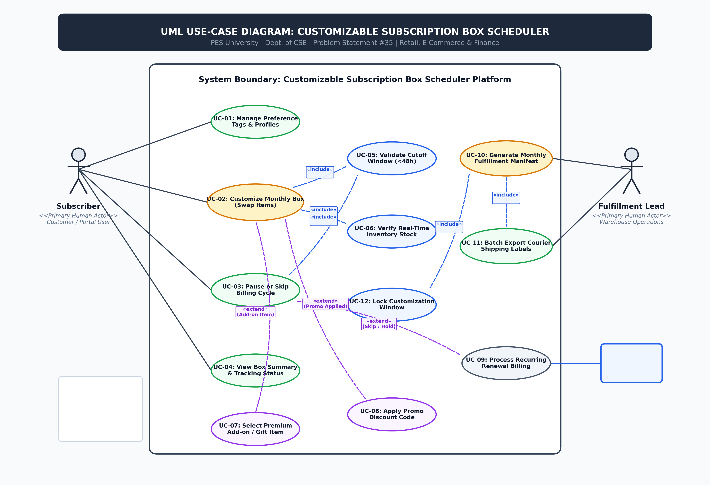
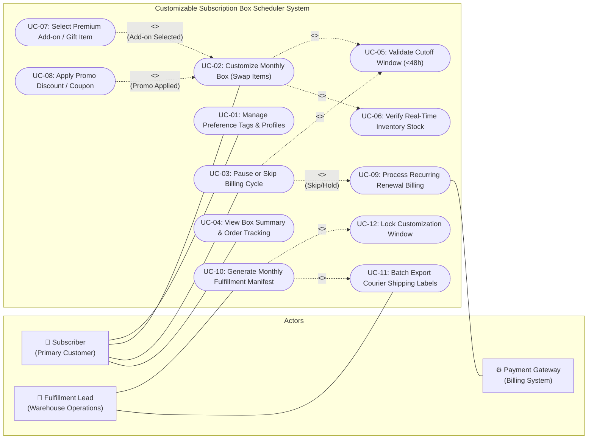

# SE Lab 1: Requirements Engineering & UML Use-Case Modelling
## Problem Statement #35: Customizable Subscription Box Scheduler
**Institution**: PES University - Department of Computer Science and Engineering  
**Course**: Software Engineering Lab (SE Lab)  
**Domain**: Retail, E-Commerce & Finance  
**Student / GitHub User**: [`unugurubharath-alt`](https://github.com/unugurubharath-alt)  
**Repository**: [unugurubharath-alt/se-lab-1](https://github.com/unugurubharath-alt/se-lab-1)  

---

## 1. Problem Context & Overview

The **Customizable Subscription Box Scheduler** is an e-commerce subscription management platform where subscribers receive recurring, curated product assortments (e.g., artisanal coffees, boutique books, gourmet snacks) tailored to personal preference tags. 

Subscribers can inspect provisional monthly box contents, swap default curated items with alternative catalog selections, update dietary/genre preference tags, or pause/skip upcoming billing cycles up to 48 hours before billing renewal. 

Concurrently, warehouse operations (**Fulfillment Leads**) aggregate finalized box orders, monitor inventory allocations, lock customization manifests, and batch-export courier shipping labels under strict SLA deadlines.

### Target Stakeholders & Actors
- **Subscriber** (*Primary Human Actor*): Customer who configures preference tags, swaps monthly box items, pauses/skips billing cycles, and tracks order shipments.
- **Fulfillment Lead** (*Primary Human Actor - Operations*): Warehouse lead who generates fulfillment manifests, monitors pick lists, and exports bulk shipping labels.
- **Payment Gateway / Billing Service** (*Secondary External System Actor*): Automated financial infrastructure handling card tokenization, recurring cycle charges, and billing date shifts.

---

## 2. Complete Requirements Table

Below is the complete requirements specification comprising exactly **5 Functional Requirements (FR-001 to FR-005)** and **2 Non-Functional Requirements (NFR-001 & NFR-002)**, each detailing its **ID, Type, Description, Priority, Acceptance Criteria, and Rationale**.

| ID | Type | Description | Priority | Acceptance Criteria | Rationale |
| :--- | :--- | :--- | :--- | :--- | :--- |
| **FR-001** | Functional | The system shall allow subscribers to swap default curated monthly box items with alternative catalog selections or pause deliveries up to 48 hours prior to the monthly billing renewal date. | **High** | **Pass**: Selection updated in database, provisional fulfillment manifest refreshed, and confirmation alert dispatched upon saving swaps prior to the 48-hour cutoff. **Fail**: Customization interface locks out prematurely (> 48 hours before renewal) or changes discarded after user confirmation. | Core value proposition of subscription boxes is personalization; subscribers churn if they receive unwanted repeat or unsuitable items. |
| **FR-002** | Functional | The system shall recommend and dynamically filter curated product selections (e.g., books, coffee roast intensity, dietary snack tags) based on user-defined preference tags and dietary/genre profiles. | **High** | **Pass**: Product catalog dynamically filters items matching chosen preference tags; default monthly box matches tagged criteria; preference tag updates persist across sessions. **Fail**: Recommended box includes items with conflicting tags (e.g., non-vegan snacks for a vegan tag) or preference changes fail to save. | Minimizes customer effort by automatically pre-populating boxes with relevant selections, maximizing engagement and perceived subscription value. |
| **FR-003** | Functional | The system shall allow subscribers to skip an upcoming billing cycle or place their subscription on hold for 1 to 3 consecutive months without cancellation penalties or loss of loyalty tier. | **High** | **Pass**: Next billing renewal date recalculates and shifts forward by the chosen duration, no renewal charge is dispatched to the Payment Gateway, and subscriber status changes to 'Paused'. **Fail**: Account is charged during paused period, or subscription status is erroneously cancelled upon pause request. | Providing self-serve pause/skip options drastically reduces churn caused by temporary travel, surplus inventory, or temporary customer financial constraints. |
| **FR-004** | Functional | The system shall dispatch automated multi-channel notifications (email and SMS/in-app push) to active subscribers at 5 days (T-5) and 48 hours (T-48h cutoff warning) prior to the billing renewal date, detailing provisional box items and the lockout deadline. | **Medium** | **Pass**: Notification triggers at scheduled intervals (T-5 days, T-48h) containing direct deep-links to customization portal with accurate provisional items; notification event logged in audit history. **Fail**: Notifications fail to dispatch, dispatch after the 48-hour cutoff, or display incorrect dates/provisional items. | Timely notifications maximize subscriber engagement, reduce disputes over auto-renewed selections, and ensure transparent billing cutoff awareness. |
| **FR-005** | Functional | The system shall aggregate finalized monthly customizations and allow the Fulfillment Lead to generate, preview, and lock the monthly fulfillment dispatch manifest once the 48-hour customization window closes. | **High** | **Pass**: Manifest consolidates all active (non-paused, non-skipped) boxes with exact item SKUs, destination postal tags, and batch IDs; further subscriber edits are strictly rejected after lock timestamp. **Fail**: Cancelled/paused accounts appear on the manifest, SKU counts do not match subscriber selections, or changes can be submitted post-lockout. | Warehouse operations require locked, deterministic packing manifests to pick, pack, and stage subscription boxes efficiently without inventory discrepancies. |
| **NFR-001** | Performance & Scalability | The fulfillment manifest generator must aggregate finalized orders and export bulk shipping labels and manifests for 10,000 monthly boxes in under 1 minute (< 60 seconds) under simulated peak load. | **High** | **Pass**: Benchmarking tests confirm end-to-end generation and export of 10,000 packing manifests and PDF/ZPL shipping labels completes in <= 58 seconds with average server CPU utilization <= 75% and RAM <= 4 GB. **Fail**: Manifest export exceeds 60 seconds, returns gateway 504 timeouts, or memory leaks cause service termination during bulk processing. | End-of-month fulfillment dispatch windows are tightly bound to courier pickup schedules; processing latency bottlenecks stall warehouse packaging lines. |
| **NFR-002** | Security & Compliance | The system shall ensure subscriber financial details comply with PCI-DSS standards (storing only tokenized payment identifiers via third-party gateways) and personal data is encrypted using AES-256 at rest and TLS 1.3 in transit, with strict Role-Based Access Control (RBAC). | **Critical** | **Pass**: Penetration audits verify zero plaintext card data stored in application databases or logs; RBAC tests confirm Fulfillment Leads access only shipping addresses and item pick lists without seeing payment credentials. **Fail**: Unencrypted sensitive PII/payment data exposed via API endpoints, stored in logs, or accessible to non-privileged roles. | Mandatory regulatory compliance (PCI-DSS, GDPR/DPDP) to protect customer data against identity theft, credential stuffing, and unauthorized internal data exposure. |

---

## 3. UML Use-Case Diagram

### High-Resolution Model Diagram

> **Vector Graphic Format**: [diagrams/use_case_diagram.svg](diagrams/use_case_diagram.svg)  
> **PlantUML Source Specification**: [diagrams/use_case_diagram.puml](diagrams/use_case_diagram.puml)

### Native Mermaid Use-Case Model

### UML Model Stereotypes & Relationships Breakdown
- **Mandatory `<<include>>` Relationships**:
  - `UC-02 (Customize Monthly Box)` `<<include>>` `UC-05 (Validate Cutoff Window <48h)`: Ensures item swaps cannot be submitted within 48 hours of billing renewal.
  - `UC-02 (Customize Monthly Box)` `<<include>>` `UC-06 (Verify Real-Time Inventory Stock)`: Guarantees available warehouse stock before confirming replacement SKUs.
  - `UC-03 (Pause or Skip Billing Cycle)` `<<include>>` `UC-05 (Validate Cutoff Window <48h)`: Enforces cycle hold deadline rules.
  - `UC-10 (Generate Monthly Fulfillment Manifest)` `<<include>>` `UC-12 (Lock Customization Window)`: Locks customer modifications upon batch manifest compilation.
  - `UC-10 (Generate Monthly Fulfillment Manifest)` `<<include>>` `UC-11 (Batch Export Courier Shipping Labels)`: Formats and initiates courier label stream.
- **Conditional `<<extend>>` Relationships**:
  - `UC-07 (Select Premium Add-on / Gift Item)` `<<extend>>` `UC-02 (Customize Monthly Box)`: Extension Point `[Add-on Requested]`. Triggers catalog expansion and micro-billing when extra items are selected.
  - `UC-08 (Apply Promo Discount / Coupon)` `<<extend>>` `UC-02 (Customize Monthly Box)`: Extension Point `[Promo Applied]`. Validates promotional codes during box review.
  - `UC-03 (Pause or Skip Billing Cycle)` `<<extend>>` `UC-09 (Process Recurring Renewal Billing)`: Extension Point `[Billing Shifted / Held]`. Alters payment scheduling when a hold is requested.

---

## 4. 1-Page Core Use-Case Flow Specification

### Core Use Case: UC-02 — Customize Monthly Box Items (Swap Products)

| Attribute | Specification Details |
| :--- | :--- |
| **Use Case ID & Name** | **UC-02: Customize Monthly Box Items (Swap Products)** |
| **Primary Actor** | **Subscriber** (Authenticated Customer) |
| **Secondary Actors** | **Warehouse Inventory Subsystem**, **Customer Notification Service** |
| **Associated FRs** | `FR-001` (Box Swapping), `FR-002` (Preference Tagging), `FR-004` (Notifications) |
| **Trigger** | Subscriber navigates to "Customize Upcoming Box" on the portal dashboard. |
| **Brief Description** | Enables an active subscriber to inspect pre-curated monthly items (books, coffee, snacks), swap default selections for alternative catalog products matching preference tags, and confirm their monthly box before the 48-hour cutoff. |

#### Preconditions
1. Subscriber is authenticated with an active, non-paused subscription.
2. Current timestamp is at least **48 hours prior** to billing renewal ($T_{\text{renewal}} - T_{\text{current}} \ge 48\text{ hours}$).
3. Monthly product catalog is published and active.

#### Postconditions
- **Success Guarantees**: Swapped SKUs overwrite defaults in database; temporary inventory reservation locks placed; provisional fulfillment manifest updated; confirmation email and in-app receipt dispatched.
- **Failure Guarantees**: Prior box configuration preserved intact; zero orphan inventory locks; clear diagnostic error message presented.

#### Main Success Scenario (Happy Path)

| Step | Subscriber (Actor Action) | System Response |
| :---: | :--- | :--- |
| **1** | Subscriber accesses dashboard and clicks **"Customize Upcoming Box"**. | Retrieves subscriber profile, preference tags, and next billing renewal schedule. |
| **2** | — | Invokes **UC-05 (Validate Cutoff Window)**; verifies $T_{\text{renewal}} - T_{\text{current}} \ge 48\text{ hours}$. |
| **3** | — | Queries catalog and displays default curated items with preference badges and countdown to lockout. |
| **4** | Subscriber clicks **"Swap Item"** on a default product. | Invokes **UC-06 (Verify Real-Time Stock)** for eligible replacement SKUs matching active tags. |
| **5** | — | Opens interactive swap modal displaying candidate products, flavor/genre notes, and stock status. |
| **6** | Subscriber selects replacement product and clicks **"Confirm Swap"**. | Validates stock reservation; updates provisional box in memory. |
| **7** | Subscriber repeats steps 4–6 for desired items, then clicks **"Confirm Box"**. | Validates box slot capacity; recalculates profile match scores. |
| **8** | Subscriber clicks **"Save & Confirm Monthly Box"**. | Commits atomic database transaction; updates warehouse packing queue. |
| **9** | — | Transmits confirmation receipt email; renders "Custom Box Confirmed" banner. |

#### Alternate Flows
- **Alternate Flow A: Customization Window Closed (< 48h Lockout)**  
  At step 2, cutoff check fails. System disables swap controls, renders warning banner (*"Customizations locked for warehouse packing"*), and presents option to update preferences for cycle $N+1$. Use case terminates.
- **Alternate Flow B: Selected Swap Product Out of Stock**  
  At step 6, replacement SKU runs out concurrently. System traps allocation error, tags item *"Temporarily Out of Stock"*, recommends nearest matching in-stock items, and keeps original choice intact.
- **Alternate Flow C: Subscriber Diverts to Pause or Skip Cycle**  
  At step 4, subscriber clicks *"Skip This Month"*. System branches to **UC-03**, confirms pause duration (1–3 months), shifts renewal date, releases inventory holds, and sends confirmation. Use case terminates.

---

## 5. Requirement Traceability Matrix (RTM)

| Requirement ID | Requirement Type | Covered In Use Case(s) | Verification Subsystem | Status |
| :--- | :--- | :--- | :--- | :--- |
| **FR-001** | Functional | UC-02, UC-05, UC-06 | Customization Engine & Cutoff Guard | **Specified & Traced** |
| **FR-002** | Functional | UC-01, UC-02 | Tag Recommendation Service | **Specified & Traced** |
| **FR-003** | Functional | UC-03, UC-05, UC-09 | Subscription Lifecycle & Billing Scheduler | **Specified & Traced** |
| **FR-004** | Functional | UC-04, Event Service | Multi-Channel Notification Pipeline | **Specified & Traced** |
| **FR-005** | Functional | UC-10, UC-12 | Manifest Aggregator & Lock Service | **Specified & Traced** |
| **NFR-001** | Performance | UC-10, UC-11 | Bulk Manifest & Label Generator (<60s) | **Specified & Traced** |
| **NFR-002** | Security | UC-09, System-wide | PCI-DSS Tokenization & RBAC Masking | **Specified & Traced** |

---

## 6. GitHub Issue, Branch & Pull Request Traceability

| Workstream | Issue | Feature Branch | Pull Request | Status |
| :--- | :---: | :--- | :---: | :---: |
| **Requirements Specification** | [#1](https://github.com/unugurubharath-alt/se-lab-1/issues/1) | `feat/requirements-spec` | [#2](https://github.com/unugurubharath-alt/se-lab-1/pull/2) | Merged & Closed |
| **UML Use-Case Modeling** | [#3](https://github.com/unugurubharath-alt/se-lab-1/issues/3) | `feat/uml-usecase-model` | [#4](https://github.com/unugurubharath-alt/se-lab-1/pull/4) | Merged & Closed |
| **Use-Case Flow Specification** | [#5](https://github.com/unugurubharath-alt/se-lab-1/issues/5) | `feat/usecase-specification` | [#6](https://github.com/unugurubharath-alt/se-lab-1/pull/6) | Merged & Closed |
| **Deliverables & Formal PDF Report** | [#7](https://github.com/unugurubharath-alt/se-lab-1/issues/7) | `docs/deliverables-and-report` | [#8](https://github.com/unugurubharath-alt/se-lab-1/pull/8) | Merged & Closed |

---

## 7. Deliverables Index

- **Formal PDF Report**: [`Lab1_Requirements_and_UseCase_Specification.pdf`](Lab1_Requirements_and_UseCase_Specification.pdf)
- **Software Requirements Specification**: [`requirements.md`](requirements.md)
- **Core Use-Case Flow Specification**: [`use_case_spec.md`](use_case_spec.md)
- **High-Resolution Diagram (PNG)**: [`diagrams/use_case_diagram.png`](diagrams/use_case_diagram.png)
- **Vector Graphic Diagram (SVG)**: [`diagrams/use_case_diagram.svg`](diagrams/use_case_diagram.svg)
- **PlantUML Model Source**: [`diagrams/use_case_diagram.puml`](diagrams/use_case_diagram.puml)
- **Diagram Documentation**: [`diagrams/README.md`](diagrams/README.md)
